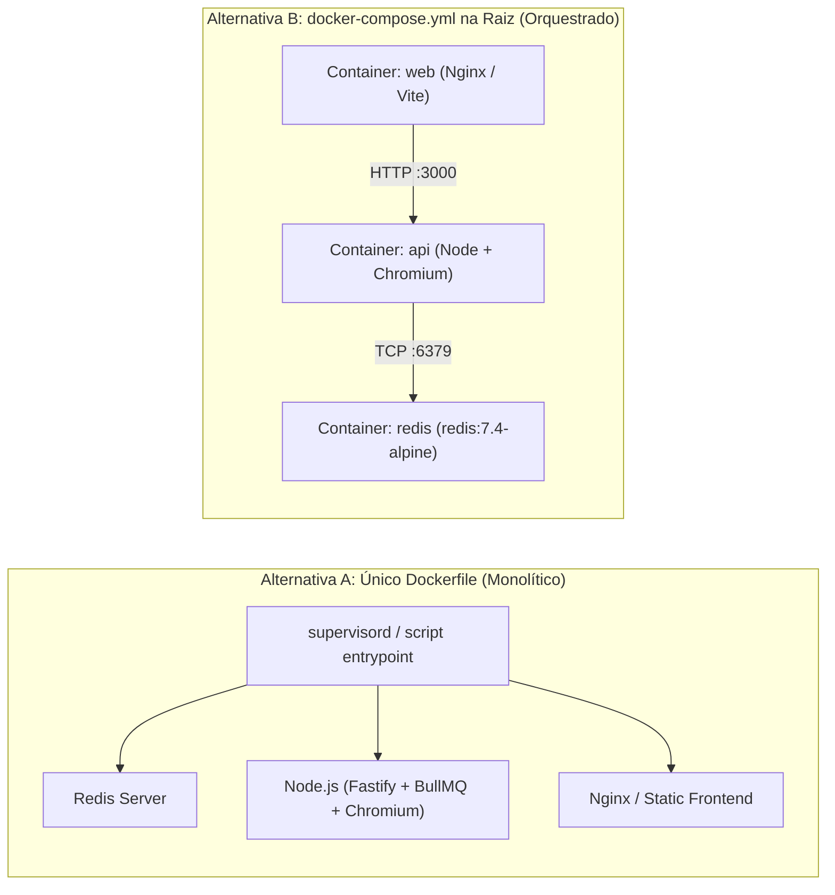

# Análise de Containerização e Plano de Ação — Vitae Studio

## 1. Contexto da Arquitetura Atual

O projeto **Vitae Studio** é composto por **3 serviços distintos** em tempo de execução:
1. **Frontend ([`web`](file:///home/dino/Área%20de%20trabalho/vitae-studio/web/package.json))**: SPA em React 19 + Vite que consome a API na porta `3000` ([`cv.service.ts`](file:///home/dino/Área%20de%20trabalho/vitae-studio/web/src/service/cv.service.ts#L4)).
2. **Backend API + Workers ([`api`](file:///home/dino/Área%20de%20trabalho/vitae-studio/api/package.json))**: Servidor Fastify + Workers do BullMQ ([`src/index.ts`](file:///home/dino/Área%20de%20trabalho/vitae-studio/api/src/index.ts#L7-L20)) que utilizam **Puppeteer** (Chromium) para scraping do LinkedIn e **Google Gemini API** para enriquecimento do currículo.
3. **Banco de Dados em Memória / Fila (`Redis`)**: Atualmente definido isoladamente em [`api/docker-compose.yml`](file:///home/dino/Área%20de%20trabalho/vitae-studio/api/docker-compose.yml), exigido pelo BullMQ e para persistência de estado das tasks.

---

## 2. Análise das Alternativas

### Alternativa A: Apenas um `Dockerfile` na raiz (Container "All-in-One")
Nessa abordagem, um único container executa o **Redis**, a **API Node.js + Chromium (Puppeteer)** e serve o **Frontend**.

* **Prós:**
  * Gera uma única imagem Docker (`docker build -t vitae-studio . && docker run ...`).
  * Possibilita que o Fastify sirva os arquivos estáticos do build do React (`web/dist`), eliminando um servidor web separado se desejado.
* **Contras:**
  * **Violação do modelo de processo único do Docker:** Requer um gerenciador de processos embutido (como `supervisord`, `s6-overlay` ou um script wrapper bash) para iniciar e monitorar o `redis-server` e o processo `node` simultaneamente.
  * **Logs misturados e difícil depuração:** Logs do Redis, Fastify, BullMQ e Puppeteer saem todos no mesmo `stdout`.
  * **Ciclo de build lento:** Qualquer alteração mínima no CSS do frontend ou no código da API invalida camadas da mesma imagem pesada (que inclui o Chromium e o Redis).
  * **Gerenciamento de estado (Volumes) e Segurança:** Rodar Redis, Chromium e Node no mesmo ambiente dificulta o isolamento de permissões (especialmente porque o Chromium exige configuração cuidadosa de sandbox/usuário não-root).

---

### Alternativa B: Único `docker-compose.yml` na raiz (Recomendada)
Nessa abordagem, um arquivo `docker-compose.yml` na raiz orquestra os 3 serviços (`redis`, `api` e `web`), utilizando Dockerfiles específicos (ou um Dockerfile multi-stage na raiz com múltiplos `target`s).

* **Prós:**
  * **Inicialização com 1 comando:** `docker compose up --build` (ou `docker compose up -d`) sobe toda a infraestrutura, rede interna, volumes do Redis e variáveis de ambiente automaticamente.
  * **Separação de responsabilidades e resiliência:** O Redis usa a imagem oficial enxuta (`redis:7.4-alpine`) com `healthcheck`. Se a API reiniciar por pico de memória do Chromium/Puppeteer, o Redis e o Frontend continuam de pé.
  * **Cache e builds rápidos:** Alterar o frontend (`web`) reconstrói apenas a imagem leve do frontend, sem precisar reinstalar pacotes do Puppeteer/Chromium da `api`.
  * **Configuração zero de portas/argumentos manuais:** Enquanto um `Dockerfile` único exige passar `-p 3000:3000 -p 5173:80 --env-file .env -v ...` no comando `docker run`, o `docker-compose.yml` já documenta e automatiza tudo isso.
* **Contras:**
  * Requer Docker Compose instalado (já incluso nativamente como `docker compose` em todas as versões modernas do Docker Desktop e Docker Engine).

> [!IMPORTANT]
> **Veredito de Viabilidade:** A **Alternativa B (`docker-compose.yml` na raiz)** é significativamente mais viável, limpa e aderente às boas práticas. Além disso, podemos combinar o melhor dos dois mundos usando **um único `Dockerfile` multi-stage na raiz** (com estágios `api` e `web`) orquestrado pelo **`docker-compose.yml` na raiz**, mantendo o repositório organizado sem espalhar vários Dockerfiles pelas subpastas.

---

## 3. Pontos Críticos no Código Atual que Precisam de Ajuste para Docker

Durante a inspeção do código-fonte, foram identificados **3 bloqueadores técnicos** que impediriam a aplicação de funcionar dentro de containers sem ajustes:

1. **Puppeteer com `headless: false` fixo no código:**
   * Em [`api/src/modules/common/factory.ts`](file:///home/dino/Área%20de%20trabalho/vitae-studio/api/src/modules/common/factory.ts#L8-L11), o `ClusterHolder` é instanciado com `headless: false`.
   * **Impacto no Docker:** Containers não possuem servidor gráfico X11 por padrão; o Puppeteer falhará imediatamente ao tentar abrir uma janela do Chrome.
   * **Solução:** Adicionar a variável `PUPPETEER_HEADLESS` (com padrão `true` em container ou configurável no [`api/src/env.ts`](file:///home/dino/Área%20de%20trabalho/vitae-studio/api/src/env.ts)) e adicionar flags essenciais para container (`--disable-dev-shm-usage`, `--disable-gpu`).

2. **Bind de rede da API em `127.0.0.1`:**
   * Em [`api/src/env.ts`](file:///home/dino/Área%20de%20trabalho/vitae-studio/api/src/env.ts#L7), `API_HOST` tem valor padrão `"127.0.0.1"`.
   * **Impacto no Docker:** Quando o Fastify escuta em `127.0.0.1` dentro de um container, o tráfego externo (da máquina host ou de outros containers) é rejeitado.
   * **Solução:** Configurar `API_HOST=0.0.0.0` no ambiente do Docker Compose.

3. **URL da API hardcoded no Frontend:**
   * Em [`web/src/service/cv.service.ts`](file:///home/dino/Área%20de%20trabalho/vitae-studio/web/src/service/cv.service.ts#L4), `CV_ENRICHMENT_API_URL` está fixo como `"http://localhost:3000"`.
   * **Solução:** Permitir leitura via `import.meta.env.VITE_API_URL || "http://localhost:3000"` para flexibilidade, mantendo `http://localhost:3000` como fallback padrão para acesso via navegador local.

---

## 4. Plano de Ação para Implementação

### Etapa 1: Ajustes de Compatibilidade no Código (`api` e `web`)
1. **[`api/src/env.ts`](file:///home/dino/Área%20de%20trabalho/vitae-studio/api/src/env.ts)**:
   * Adicionar suporte a `PUPPETEER_HEADLESS` (booleano, default `true` ou controlado por env) e `PUPPETEER_EXECUTABLE_PATH` (opcional, para usar o Chromium do sistema no container evitando download duplicado de ~300MB).
2. **[`api/src/modules/common/factory.ts`](file:///home/dino/Área%20de%20trabalho/vitae-studio/api/src/modules/common/factory.ts)**:
   * Atualizar a configuração do `ClusterHolder` para utilizar `headless: env.PUPPETEER_HEADLESS`, `executablePath: env.PUPPETEER_EXECUTABLE_PATH`, e os argumentos `["--no-sandbox", "--disable-setuid-sandbox", "--disable-dev-shm-usage", "--disable-gpu"]`.
3. **[`web/src/service/cv.service.ts`](file:///home/dino/Área%20de%20trabalho/vitae-studio/web/src/service/cv.service.ts)**:
   * Alterar `CV_ENRICHMENT_API_URL` para `import.meta.env.VITE_API_URL || "http://localhost:3000"`.

### Etapa 2: Criação do `Dockerfile` (Multi-stage na Raiz) e `.dockerignore`
1. Criar [`.dockerignore`](file:///home/dino/Área%20de%20trabalho/vitae-studio/.dockerignore) na raiz ignorando `node_modules`, `dist`, `.git`, `.gradle` para acelerar o contexto de build.
2. Criar um único [`Dockerfile`](file:///home/dino/Área%20de%20trabalho/vitae-studio/Dockerfile) multi-stage na raiz contendo:
   * **Target `api`**: Baseado em `node:22-bookworm-slim`, instalando o `chromium` e fontes necessárias via `apt`, rodando `npm ci` e `npm run build` da pasta `api`, e configurando `PUPPETEER_SKIP_CHROMIUM_DOWNLOAD=true` + `PUPPETEER_EXECUTABLE_PATH=/usr/bin/chromium`.
   * **Target `web`**: Estágio de build (`node:22-alpine`) que compila o Vite (`npm run build` em `web/`) e estágio final (`nginx:alpine`) que serve a aplicação estática na porta `80` (mapeada para `5173` ou `8080` no host).

### Etapa 3: Criação do `docker-compose.yml` na Raiz
1. Criar [`docker-compose.yml`](file:///home/dino/Área%20de%20trabalho/vitae-studio/docker-compose.yml) na raiz com os 3 serviços:
   * `redis`: `redis:7.4-alpine` com `healthcheck` (`redis-cli ping`) e volume persistente `redis_data`.
   * `api`: constrói o target `api` do `Dockerfile` raiz, depende do `redis` saudável (`condition: service_healthy`), injeta `API_HOST=0.0.0.0`, `REDIS_HOST=redis`, `PUPPETEER_HEADLESS=true`, monta o volume `./api/resources:/app/resources` (para persistir o `settings.json` configurado pela UI no primeiro acesso e eventuais cookies do LinkedIn) e expõe a porta `3000:3000` (sem necessidade de arquivo `.env` manual).
   * `web`: constrói o target `web` do `Dockerfile` raiz, expõe a porta `5173:80` e depende da `api`.
2. Remover o antigo [`api/docker-compose.yml`](file:///home/dino/Área%20de%20trabalho/vitae-studio/api/docker-compose.yml) para evitar duplicidade.
3. Atualizar o [`README.md`](file:///home/dino/Área%20de%20trabalho/vitae-studio/README.md) com o passo único de execução via `docker compose up --build` e configuração inicial diretamente pela interface web.
