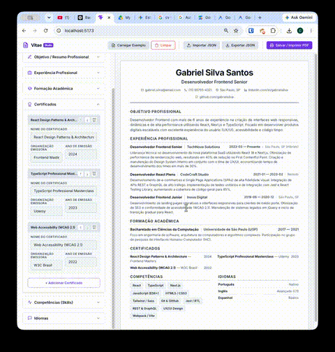

# 🌟 Vitae Studio — Construtor de Currículos Profissional & AI Tailoring

O **Vitae Studio** é um ecossistema completo para a criação e otimização de currículos profissionais. Ele é estruturado como um monorepo composto por um frontend interativo e uma API de suporte para análise inteligente de vagas.

---

## 📸 Demonstração da Plataforma (Frontend)



---

## ⚡ Inicialização Rápida com Docker (Recomendado)

Toda a stack (**Frontend**, **Backend API com Chromium/Puppeteer** e **Redis**) pode ser executada com **apenas um comando** na raiz do projeto, sem necessidade de instalar dependências locais ou configurar arquivos `.env` manualmente.

### Pré-requisito
* [Docker](https://docs.docker.com/get-docker/) e [Docker Compose](https://docs.docker.com/compose/) instalados.

### Executando com 1 comando:
```bash
docker compose up --build
```
*(ou em segundo plano: `docker compose up -d --build`)*

Acesse no navegador:
* 🌐 **Frontend**: [http://localhost:5173](http://localhost:5173)
* ⚡ **Backend API**: [http://localhost:3000](http://localhost:3000)

> [!TIP]
> **Zero configuração de `.env` manual!**
> Ao abrir a interface pela primeira vez, um modal interativo de boas-vindas permite configurar sua chave de API e selecionar o provedor desejado (**Google Gemini**, **OpenAI** ou **OpenAPI / 9router**). As credenciais são salvas e persistidas automaticamente no volume local `./api/resources`.

---

## 📂 Estrutura do Monorepo

O projeto está dividido em duas partes principais:

### 1. 🌐 [Frontend (web)](./web)
Interface de usuário construída em **React 19, TypeScript e Vite** com **CSS Vanilla**.
* **Visualização WYSIWYG**: Renderiza uma prévia A4 perfeita em tempo real.
* **Barra Lateral Ajustável**: Sidebar de formulários redimensionável (Drag-to-Resize).
* **Temas e Estilos**: Customização dinâmica de cores, tipografia e espaçamentos.
* **Configuração de IA Integrada**: Modal nativo para gerenciar provedores, testar conexão e listar modelos dinamicamente.
* **Exportação Otimizada**: Impressão limpa via `@media print` para gerar PDFs A4 perfeitamente formatados.

### 2. ⚡ [Backend API (api)](./api)
API REST de apoio desenvolvida em **Node.js, TypeScript e Fastify** para processamento de tarefas em segundo plano (Jobs).
* **Fila de Processamento**: Gerenciada com **Redis** e **BullMQ** para rodar tarefas assíncronas em segundo plano sem travar o cliente.
* **LinkedIn Scraping**: Extração automatizada de informações de vagas usando **Puppeteer** em modo *Headless* com *Stealth Plugin*.
* **Otimização com IA Multi-Provedor**: Suporte nativo a **Google Gemini** (`gemini-3.5-flash-lite`, `gemini-3.5-flash`, `gemini-2.5-flash`), **OpenAI** e qualquer gateway compatível com **OpenAPI / 9router**.

---

## 🛠️ Execução Local para Desenvolvimento (Sem Docker)

Caso prefira rodar os serviços localmente durante o desenvolvimento:

### 1. Inicie o Redis
```bash
# Caso tenha o Redis local instalado:
redis-server
```

### 2. Inicie a API (`api`)
```bash
cd api
npm install
npm run dev
```
A API estará disponível em `http://localhost:3000`.

### 3. Inicie o Frontend (`web`)
```bash
cd web
npm install
npm run dev
```
O frontend estará disponível em `http://localhost:5173`.
