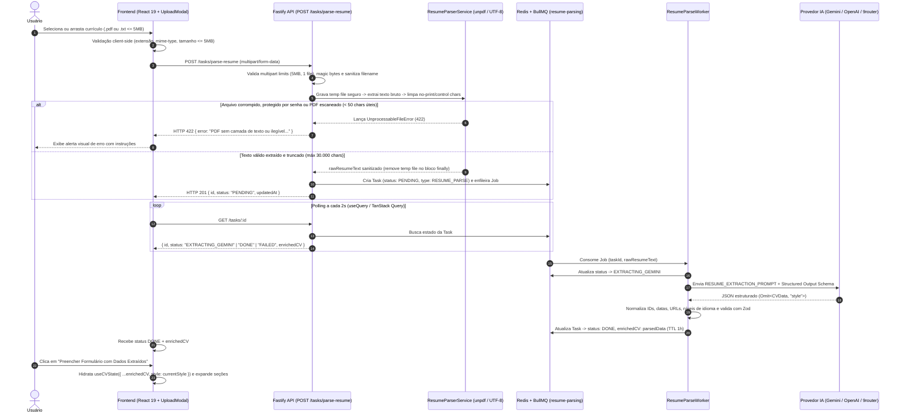

# Plano de Implementação Técnica: Ingestão e Extração Automática de Currículos (PDF/TXT) via IA

## Visão Geral (Overview)
Implementar o fluxo completo de **ingestão de arquivos de currículo (`.pdf` textual e `.txt`)** com extração automática de entidades estruturadas via LLM (Google Gemini, OpenAI ou provedor compatível OpenAPI/9router) e **pré-preenchimento (hidratação) reativo** de todos os campos do editor do Vitae Studio, mantendo 100% de compatibilidade com o schema `CVData`, preservando o estilo (`StyleConfig`) atual do usuário e permitindo revisão e edição manual antes da exportação/impressão.

- **Project Type:** FULLSTACK WEB (`api` Fastify + BullMQ/Redis & `web` React 19 + Vite)
- **Slug do Plano:** `resume-file-ingestion.md`

---

## Critérios de Sucesso (Success Criteria)
1. **Upload Seguro & Validação Estrita:** Aceitar apenas arquivos `.pdf` (`application/pdf`) e `.txt` (`text/plain`) de até **5MB**, validando assinatura binária (*magic bytes* `%PDF-` para PDFs e ausência de bytes nulos para TXT) e sanitizando nomes de arquivos.
2. **Extração Textual Resiliente (Fail-Fast):** Extrair texto bruto de PDFs e TXTs em memória/arquivo temporário seguro, rejeitando imediatamente (`422 Unprocessable Entity`) PDFs escaneados (somente imagem), protegidos por senha ou corrompidos antes de consumir tokens da LLM.
3. **Processamento Assíncrono via BullMQ + Redis:** Enfileirar a estruturação por IA reutilizando o controle de concorrência e *rate-limiting* (`5 req/min`), suportando os 3 provedores configurados (`gemini`, `openai`, `openai-compatible`).
4. **Contrato 1:1 com `CVData`:** Retornar `Omit<CVData, "style">` validado por Zod, com IDs únicos gerados (`exp-...`, `edu-...`, `cert-...`, `lang-...`), datas normalizadas e níveis de idioma compatíveis com o `<select>` do frontend (`Nativo | Fluente | Avançado | Intermediário | Básico`).
5. **UX de Upload e Hidratação Não-Destrutiva:** Disponibilizar botão/modal com zona de Drag-and-Drop na barra superior, feedback de progresso em tempo real e hidratação do estado `cvData` preservando `cvData.style` e abrindo automaticamente as seções preenchidas no `CVEditor`.

---

## 1. Visão Geral e Arquitetura do Fluxo

### Diagrama do Ciclo de Vida da Requisição



---

## 2. Dependências e Infraestrutura

### Novas Dependências no Backend (`api/package.json`)

| Pacote | Versão | Tipo | Justificativa Técnica |
| :--- | :--- | :--- | :--- |
| `@fastify/multipart` | `^9.0.3` | `dependencies` | Plugin oficial do Fastify v5 para processamento de `multipart/form-data` com controle nativo de streaming, limites estritos de bytes (`fileSize: 5 * 1024 * 1024`) e limite de partes (`files: 1`), prevenindo ataques de exaustão de memória. |
| `unpdf` | `^1.0.0` | `dependencies` | Biblioteca moderna baseada na build serverless do Mozilla `pdf.js` (Zero dependências nativas C++/Canvas, 100% compatível com ESM, TypeScript e `esbuild`). Ao contrário do pacote legado `pdf-parse` (que quebra em bundlers ESM como o `esbuild.config.mjs` do nosso projeto devido a arquivos de teste hardcoded no `index.js`), o `unpdf` funciona perfeitamente com `esbuild` e Node 22 (`node:22-bookworm-slim`). |

> **Nota sobre o Frontend (`web/package.json`):** Nenhuma dependência extra é necessária. A zona de Drag-and-Drop será implementada com eventos nativos do React (`onDragOver`, `onDragLeave`, `onDrop`) e upload via `FormData` no cliente `axios` já instalado, mantendo o bundle enxuto e consistente com o restante do projeto.

---

## 3. Contrato de Dados (JSON Schema & Mapeamento 1:1)

### 3.1. Modelo Alvo no Sistema (`Omit<CVData, "style">`)
A LLM deve retornar exatamente a estrutura de conteúdo do currículo definida em `api/src/modules/common/model/cv.model.ts` e validada pelo `enrichedCVSchema` (`api/src/modules/http/schema/task.schema.ts`):

```json
{
  "$schema": "http://json-schema.org/draft-07/schema#",
  "title": "ExtractedResumeData",
  "type": "object",
  "required": [
    "personal",
    "objective",
    "experience",
    "education",
    "certificates",
    "skills",
    "languages"
  ],
  "properties": {
    "personal": {
      "type": "object",
      "required": ["fullName", "title", "email", "phone", "location", "linkedin", "github"],
      "properties": {
        "fullName": { "type": "string", "description": "Nome completo do candidato ou '' se ausente" },
        "title": { "type": "string", "description": "Cargo principal / título profissional desejado ou atual" },
        "email": { "type": "string", "description": "E-mail principal de contato" },
        "phone": { "type": "string", "description": "Telefone principal formatado (se houver múltiplos, apenas o principal/celular)" },
        "location": { "type": "string", "description": "Cidade, UF ou País (ex: 'São Paulo, SP')" },
        "linkedin": { "type": "string", "description": "URL do LinkedIn sem https:// (ex: 'linkedin.com/in/usuario')" },
        "github": { "type": "string", "description": "URL do GitHub ou portfólio técnico sem https:// (ex: 'github.com/usuario')" }
      }
    },
    "objective": {
      "type": "string",
      "description": "Resumo profissional ou objetivo de carreira extraído do currículo"
    },
    "experience": {
      "type": "array",
      "description": "Experiências profissionais e projetos relevantes (quando não houver seção própria)",
      "items": {
        "type": "object",
        "required": ["id", "company", "role", "location", "startDate", "endDate", "description"],
        "properties": {
          "id": { "type": "string", "description": "Identificador sequencial ex: 'exp-1', 'exp-2'" },
          "company": { "type": "string", "description": "Nome da empresa ou 'Projeto Independente / Acadêmico'" },
          "role": { "type": "string", "description": "Cargo ocupado ou nome do projeto" },
          "location": { "type": "string", "description": "Cidade/Estado, 'Remoto' ou ''" },
          "startDate": { "type": "string", "description": "Data inicial no formato 'MM/AAAA' ou 'AAAA'" },
          "endDate": { "type": "string", "description": "Data final no formato 'MM/AAAA', 'AAAA' ou '' se for o emprego atual" },
          "description": { "type": "string", "description": "Responsabilidades e conquistas separadas por quebras de linha com marcador '- '" }
        }
      }
    },
    "education": {
      "type": "array",
      "items": {
        "type": "object",
        "required": ["id", "institution", "degree", "startDate", "endDate", "description"],
        "properties": {
          "id": { "type": "string", "description": "Identificador sequencial ex: 'edu-1'" },
          "institution": { "type": "string", "description": "Nome da instituição de ensino" },
          "degree": { "type": "string", "description": "Grau e nome do curso (ex: 'Bacharelado em Ciência da Computação')" },
          "startDate": { "type": "string", "description": "Ano ou Mês/Ano de início" },
          "endDate": { "type": "string", "description": "Ano ou Mês/Ano de conclusão (ou previsão)" },
          "description": { "type": "string", "description": "Destaques acadêmicos, TCC, bolsas ou ''" }
        }
      }
    },
    "certificates": {
      "type": "array",
      "items": {
        "type": "object",
        "required": ["id", "name", "organization", "date"],
        "properties": {
          "id": { "type": "string", "description": "Identificador sequencial ex: 'cert-1'" },
          "name": { "type": "string", "description": "Nome do curso ou certificação" },
          "organization": { "type": "string", "description": "Instituição emissora (ex: 'AWS', 'Alura')" },
          "date": { "type": "string", "description": "Ano ou Mês/Ano de emissão" }
        }
      }
    },
    "skills": {
      "type": "array",
      "description": "Lista unificada de Hard Skills e Soft Skills atômicas",
      "items": { "type": "string" }
    },
    "languages": {
      "type": "array",
      "items": {
        "type": "object",
        "required": ["id", "name", "level"],
        "properties": {
          "id": { "type": "string", "description": "Identificador sequencial ex: 'lang-1'" },
          "name": { "type": "string", "description": "Nome do idioma (ex: 'Inglês', 'Espanhol')" },
          "level": {
            "type": "string",
            "enum": ["Nativo", "Fluente", "Avançado", "Intermediário", "Básico"],
            "description": "Nível mapeado estritamente para uma das 5 opções do formulário"
          }
        }
      }
    }
  }
}
```

### 3.2. Regras de Mapeamento de Casos Indeterminados (Prompt + Normalizador Pós-LLM)
1. **Datas Incompletas ou "Atual / Presente":**
   - Se o documento informar apenas o ano (`2022`), manter `"2022"`. Se informar mês e ano (`Março 2022`), converter para `"03/2022"`.
   - Se a experiência estiver em andamento (`Atual`, `Presente`, `Atualmente`, `Current`, `Até o momento`), converter `endDate` obrigatoriamente para `""` (string vazia), que o preview do Vitae Studio renderiza automaticamente como *"Presente"*.
2. **Múltiplos Telefones / E-mails:**
   - Extrair apenas o primeiro telefone principal (preferencialmente celular/WhatsApp) para `personal.phone` e o primeiro e-mail para `personal.email`.
3. **Projetos Relevantes:**
   - Como o schema `CVData` não possui chave `projects`, projetos de destaque listados no currículo são mapeados para `experience` com `company: "Projeto Pessoal"` (ou instituição vinculada) e `role: "Projeto — <Nome do Projeto>"`.
4. **Normalização de Nível de Idiomas (`normalizeLanguageLevel`):**
   - No pós-processamento TypeScript (`normalizeExtractedCV`), qualquer variação retornada pela IA (ex: `C1`, `C2`, `B2`, `Advanced`, `Técnico`, `Leitura`) é convertida de forma determinística para um dos 5 valores aceitos pelo `<select>` do `LanguagesForm`: `"Nativo" | "Fluente" | "Avançado" | "Intermediário" | "Básico"`.
5. **Geração Garantida de IDs:**
   - Ainda que a LLM omita ou repita IDs, o normalizador pós-LLM sobrescreve/garante IDs únicos determinísticos: `exp-${Date.now()}-${idx}`, `edu-${Date.now()}-${idx}`, `cert-${Date.now()}-${idx}`, `lang-${Date.now()}-${idx}`.

---

## 4. Design dos Serviços (Backend)

### 4.1. Arquitetura de Arquivos a Criar/Modificar no Backend

```text
api/src/
├── modules/
│   ├── enrichment/
│   │   ├── parser/
│   │   │   ├── file-validator.ts            # [NOVO] Validação de MIME, extensão, tamanho (5MB) e Magic Bytes (%PDF- / UTF-8)
│   │   │   ├── text-extractor.service.ts    # [NOVO] Extração de texto (.pdf via unpdf e .txt via fs) + sanitização + truncamento
│   │   │   ├── resume-extraction.prompt.ts  # [NOVO] Prompt estruturado de extração 1:1 para CVData
│   │   │   └── resume-parser.worker.ts      # [NOVO] Worker BullMQ que invoca a LLM para extrair o currículo do texto bruto
│   │   ├── gemini/
│   │   │   ├── gemini.ts                    # [MOD] Adiciona extractCVFromTextWithAI() e extractCVFromTextWithGemini()
│   │   │   └── gemini.schema.ts             # [MOD] Ajusta descrições de CVResponseSchema para suportar tanto enriquecimento quanto extração
│   │   ├── ai/
│   │   │   └── openai-compatible.provider.ts# [MOD] Adiciona extractCVFromTextWithOpenAICompatible() e normalizeExtractedCV()
│   │   ├── model/
│   │   │   └── task.model.ts                # [MOD] Suporte opcional a taskType ('LINKEDIN_ENRICH' | 'RESUME_PARSE') e rawResumeText
│   │   ├── services/
│   │   │   └── task.service.ts              # [MOD] Adiciona createResumeParseTask(rawResumeText: string)
│   │   └── queue.ts                         # [MOD] Adiciona addResumeParseJob() e worker para parsing com rate-limit compartilhado
│   └── http/
│       ├── index.ts                         # [MOD] Registra @fastify/multipart com limites de 5MB e 1 arquivo
│       ├── router.ts                        # [MOD] Registra POST /tasks/parse-resume
│       ├── controllers/
│       │   └── task.controller.ts           # [MOD] Adiciona método parseResume(request, reply)
│       └── schema/
│           └── task.schema.ts               # [MOD] Adiciona parseResumeResponseSchema (201, 400, 413, 415, 422)
└── util/
    └── errors.ts                            # [MOD] Adiciona InvalidFileUploadError (400/415) e UnprocessableResumeError (422)
```

### 4.2. Detalhamento das Classes e Serviços

1. **`FileValidator` (`api/src/modules/enrichment/parser/file-validator.ts`):**
   - Verifica `mimetype` (`application/pdf` ou `text/plain`) e extensão (`.pdf` ou `.txt`).
   - Sanitiza o nome do arquivo (`path.basename(filename).replace(/[^a-zA-Z0-9._-]/g, '_')`).
   - Valida **Magic Bytes**:
     - Para `.pdf`: verifica se os primeiros 5 bytes do buffer correspondem a `0x25 0x50 0x44 0x46 0x2D` (`%PDF-`).
     - Para `.txt`: verifica ausência de bytes nulos (`0x00`) nos primeiros 4KB para impedir upload de executáveis/binários renomeados para `.txt`.

2. **`TextExtractorService` (`api/src/modules/enrichment/parser/text-extractor.service.ts`):**
   - Salva o buffer temporariamente em `/tmp/vitae-uploads/${uuid}-${sanitizedName}` com permissão restrita (`0o600`), garantindo remoção no bloco `finally`.
   - **Extração `.txt`:** Decodifica via `TextDecoder('utf-8', { fatal: false })`, normalizando quebras de linha (`\r\n` -> `\n`).
   - **Extração `.pdf`:** Utiliza `extractText( new Uint8Array(buffer), { mergePages: true } )` da biblioteca `unpdf`.
   - **Limpeza e Truncamento (`sanitizeAndTruncateText`):**
     - Remove caracteres de controle ASCII não imprimíveis (`[\x00-\x08\x0B\x0C\x0E-\x1F\x7F]`).
     - Colapsa múltiplas linhas em branco consecutivas (`\n{3,}` -> `\n\n`) e espaços repetidos.
     - Verifica se o texto limpo possui no mínimo **50 caracteres alfanuméricos**; caso contrário, lança `UnprocessableResumeError` (422: *"O arquivo enviado não contém texto legível suficiente. Se for um PDF escaneado como imagem, envie uma versão em PDF selecionável ou TXT."*).
     - Trunca de forma segura em **`MAX_RESUME_CHARS = 30000`** (~7.500 tokens), mais do que suficiente para currículos extensos de 5+ páginas e totalmente seguro para a janela de contexto de qualquer LLM.

3. **Decisão Síncrono vs. Assíncrono (Arquitetura Híbrida em 2 Estágios):**
   - **Estágio 1 — Síncrono no Request HTTP (`POST /tasks/parse-resume`):** Recebimento do arquivo, gravação temporária segura, validação de Magic Bytes e extração do texto bruto (`unpdf` / UTF-8). Como isso leva **< 80ms**, erros de arquivo inválido, corrompido ou PDF escaneado retornam imediatamente (`400`, `413`, `415` ou `422`) sem criar tarefas inúteis no Redis.
   - **Estágio 2 — Assíncrono via BullMQ (`resume-parse` job na `geminiQueue`):** Com o texto bruto validado em mãos, o `TaskService.createResumeParseTask(rawResumeText)` cria a Task no Redis (`tasks:${id}` com TTL de 3600s) e publica na fila BullMQ, retornando `201 Created` com `{ id, status: "PENDING" }`. O frontend utiliza exatamente o mesmo endpoint `GET /tasks/:id` para fazer polling a cada 2 segundos até `status === 'DONE'`.

---

## 5. Integração no Frontend

### 5.1. Fluxo de Interface e Componentes

```text
web/src/
├── components/
│   ├── resume-upload-modal.component.tsx    # [NOVO] Modal com Dropzone (.pdf/.txt), estados de progresso e revisão antes de hidratar
│   ├── resume-upload-modal.component.css    # [NOVO] Estilização da Dropzone, animações de drag-over e estados de feedback
│   └── navbar.component.tsx                 # [MOD] Novo botão de destaque "Importar Currículo (PDF/TXT)" na barra superior
├── hooks/
│   ├── resume-upload.hook.ts                # [NOVO] Hook React Query (mutation de upload + polling via GET /tasks/:id)
│   └── cv-state.hook.ts                     # [MOD] Método hydrateFromExtractedCV(extracted: Omit<CVData, 'style'>)
├── components/editor/
│   └── cv-editor.component.tsx              # [MOD] Expande automaticamente as seções que receberam itens após importação
└── service/
    └── cv.service.ts                        # [MOD] Adiciona uploadResumeForParsing(file: File) via multipart/form-data
```

### 5.2. Estratégia de Hidratação do Formulário (`useCVState`)
1. **Não-Submissão Automática & Preservação de Estilo:**
   - Quando a IA finaliza a extração (`status === 'DONE'`), o modal exibe um resumo quantitativo dos itens identificados (ex: *"Dados pessoais + 3 experiências + 2 formações + 8 competências encontradas"*) e o botão **"Preencher Formulário"**.
   - Ao confirmar, `hydrateFromExtractedCV(extractedCV)` atualiza o estado em `useCVState` combinando os dados extraídos com o `cvData.style` atual:
     ```ts
     setCvData(prev => ({
       ...extractedCV,
       style: prev.style
     }));
     ```
2. **Inputs Dinâmicos (Listas de Experiências, Formação, Certificados, Idiomas e Skills):**
   - Como `ExperienceForm`, `EducationForm`, `CertificatesForm`, `LanguagesForm` e `SkillsForm` são *controlled components* guiados por `cvData` e indexados por `item.id`, a atualização de `cvData` hidrata instantaneamente todos os cards dinâmicos.
   - O `CVEditor` observará a hidratação para abrir automaticamente (`openSections`) as seções que possuírem dados preenchidos, facilitando a revisão visual imediata pelo usuário.

---

## 6. Segurança e Tratamento de Exceções

| Vetor de Risco / Exceção | Camada de Mitigação Implementada |
| :--- | :--- |
| **Upload de arquivos gigantes (DoS de memória/disco)** | Limite estrito configurado no `@fastify/multipart` (`limits: { fileSize: 5 * 1024 * 1024, files: 1 }`) + validação prévia no Frontend (`file.size > 5 * 1024 * 1024`). Retorna `413 Payload Too Large`. |
| **Spoofing de extensão/MIME (ex: `.exe` renomeado para `.pdf`)** | Inspeção de *Magic Bytes* no buffer (`%PDF-` para PDFs e verificação de ausência de Null Bytes para TXT) em `file-validator.ts`. |
| **Path Traversal no nome do arquivo** | Sanitização de nome via `path.basename` + regex `[^a-zA-Z0-9._-]` + prefixo `uuidv4()` gravado exclusivamente em `os.tmpdir()` e removido em bloco `try / finally`. |
| **PDF Escaneado (Imagem sem OCR) ou Em Branco** | Checagem de densidade mínima de caracteres (`cleanedText.replace(/\s+/g, '').length < 50`). Rejeita com `422 Unprocessable Entity` **antes** de chamar a LLM, economizando 100% de tokens em arquivos inválidos. |
| **Estouro de Contexto de Tokens & Prompt Injection** | Truncamento seguro em `30.000` caracteres (`~7.500 tokens`) + delimitação explícita do conteúdo do documento com tags `<resume_document>...</resume_document>` e instrução de sistema ignorando comandos embutidos no currículo. |
| **Timeouts, Rate Limit (429) e JSON Malformado da LLM** | Reaproveitamento da fila BullMQ com `attempts: 3`, *exponential backoff* (`15s`), timeout de requisição configurável, limpeza de tags `<think>`/markdown via `extractJsonFromText` e validação/fallback campo-a-campo com `normalizeExtractedCV` + Zod. |

---

## 7. Roteiro de Implementação Passo a Passo (Task Checklist)

### Fase 1: Backend — Dependências, Validação e Extração de Texto (`@backend-specialist`)
- [x] **Task 1.1:** Instalar `@fastify/multipart` e `unpdf` em `api/package.json` e validar build com `esbuild`.
  - *INPUT:* `api/package.json`
  - *OUTPUT:* Dependências instaladas e compatíveis com `npm run build`
  - *VERIFY:* `cd api && npm run type-check`
- [x] **Task 1.2:** Criar classes de erro de domínio (`InvalidFileUploadError`, `UnprocessableResumeError`) em `api/src/util/errors.ts`.
  - *INPUT:* `api/src/util/errors.ts`
  - *OUTPUT:* Novas classes de erro com status HTTP `400`/`415`/`422`
  - *VERIFY:* Importação sem erros de compilação
- [x] **Task 1.3:** Implementar `file-validator.ts` e `text-extractor.service.ts` em `api/src/modules/enrichment/parser/` (validação de 5MB, magic bytes `%PDF-`, armazenamento temporário com limpeza `finally`, extração com `unpdf` e `UTF-8`, sanitização de caracteres de controle e truncamento em 30k chars).
  - *INPUT:* Buffer e metadados do arquivo multipart
  - *OUTPUT:* Texto bruto limpo ou exceção tipada
  - *VERIFY:* Teste unitário com buffers `.txt`, `.pdf` válido e arquivo vazio/inválido

### Fase 2: Prompt Engineering & Integração Multi-LLM (`@backend-specialist`)
- [x] **Task 2.1:** Criar `resume-extraction.prompt.ts` com instruções estritas de extração 1:1 para `CVData` (tratamento de datas `MM/AAAA` ou `AAAA`, `endDate: ""` para emprego atual, projetos mapeados em `experience`, telefone único e níveis de idioma padronizados).
  - *INPUT:* Texto bruto do currículo
  - *OUTPUT:* Prompt otimizado com bloqueio de prompt injection
  - *VERIFY:* Inspeção do template e testes de contrato
- [x] **Task 2.2:** Implementar `normalizeExtractedCV()` em `openai-compatible.provider.ts` e `extractCVFromTextWithAI()` em `gemini.ts` (suportando Google Gemini com `responseSchema`, OpenAI e OpenAPI/9router).
  - *INPUT:* Texto bruto extraído + configurações do `SettingsService`
  - *OUTPUT:* `Result<ApplicationError, Omit<CVData, "style">>` validado pelo `enrichedCVSchema`
  - *VERIFY:* `cd api && npm run type-check`

### Fase 3: Fila Assíncrona, Controller e Rota HTTP (`@backend-specialist`)
- [x] **Task 3.1:** Atualizar `task.model.ts`, `task.service.ts`, `queue.ts` e `gemini.worker.ts` para processar jobs de estruturação de currículo via BullMQ.
  - *INPUT:* `rawResumeText` validado
  - *OUTPUT:* Task persistida no Redis e processada em background pelo worker
  - *VERIFY:* Enfileiramento e transição `PENDING` -> `EXTRACTING_GEMINI` -> `DONE`
- [x] **Task 3.2:** Registrar `@fastify/multipart` em `api/src/modules/http/index.ts` e criar o endpoint `POST /tasks/parse-resume` em `router.ts`, `task.controller.ts` e `task.schema.ts`.
  - *INPUT:* Requisição `multipart/form-data` com campo `file`
  - *OUTPUT:* HTTP `201` com `TaskResponseDTO` ou erro `400`/`413`/`415`/`422`
  - *VERIFY:* Chamada HTTP para `POST /tasks/parse-resume`

### Fase 4: Frontend — Dropzone Modal, Polling e Hidratação (`@frontend-specialist`)
- [x] **Task 4.1:** Adicionar `createResumeParseTask(file: File)` em `web/src/service/cv.service.ts` e criar o hook `useResumeUpload` em `web/src/hooks/resume-upload.hook.ts`.
  - *INPUT:* `File` selecionado pelo usuário
  - *OUTPUT:* Estados reativos (`isPending`, `progress`, `statusLabel`, `extractedCV`, `errorMessage`)
  - *VERIFY:* `cd web && npm run build`
- [x] **Task 4.2:** Criar o componente `ResumeUploadModal` (`resume-upload-modal.component.tsx` + `.css`) com zona de Drag-and-Drop, validação de arquivo no cliente, barra de progresso por etapa, resumo de entidades extraídas e botão de confirmação.
  - *INPUT:* Estado do `useResumeUpload`
  - *OUTPUT:* Modal interativo seguindo a identidade visual do Vitae Studio
  - *VERIFY:* Renderização sem erros de lint/build
- [x] **Task 4.3:** Integrar a hidratação de estado com auto-expansão das seções populadas no `CVEditor` e adicionar o botão **"Importar PDF/TXT"** na `Navbar` e no `App.tsx`.
  - *INPUT:* `extractedCV` retornado pela API
  - *OUTPUT:* Formulário lateral e Preview A4 preenchidos preservando `cvData.style`
  - *VERIFY:* Fluxo ponta-a-ponta no navegador

### Fase X: Testes Automatizados e Verificação Final (`@test-engineer`)
- [x] **Task X.1:** Criar testes unitários para validação de arquivos, extração de texto (PDF/TXT) e normalização de dados extraídos da LLM (`api/src/modules/enrichment/parser/parser.test.ts`).
- [x] **Task X.2:** Executar validação de tipos, testes e build em ambos os pacotes (`api` e `web`).

---

## ✅ PHASE X COMPLETE
- Lint & Type-Check (`api` & `web`): ✅ Pass
- Unit Tests (`vitest` — 9/9 passed): ✅ Pass
- Build (`api` & `web`): ✅ Success
- Date: 2026-11-09
